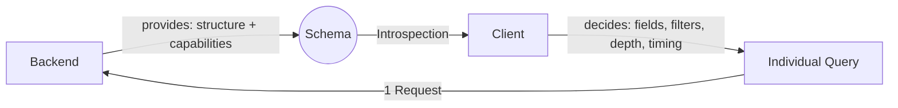
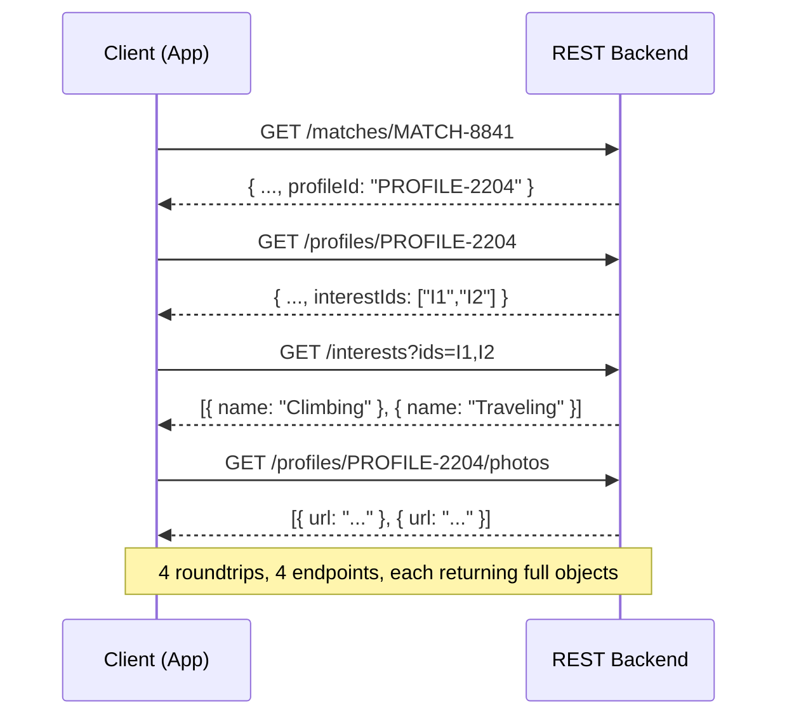
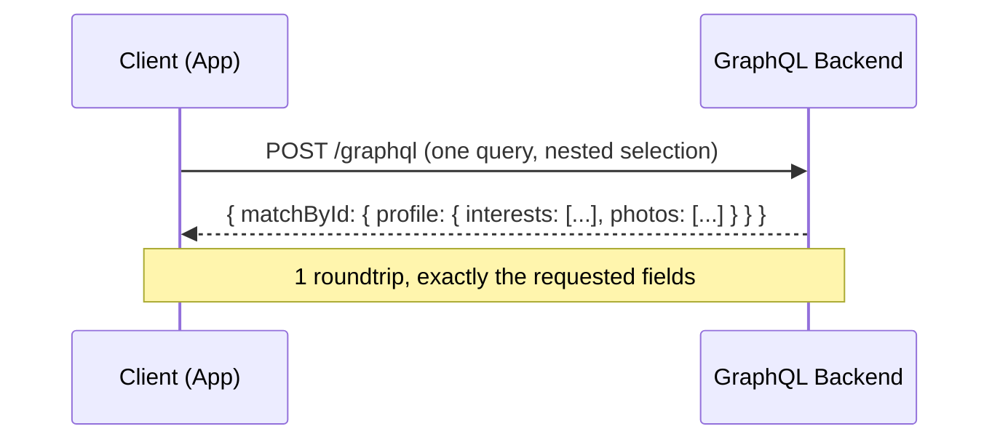
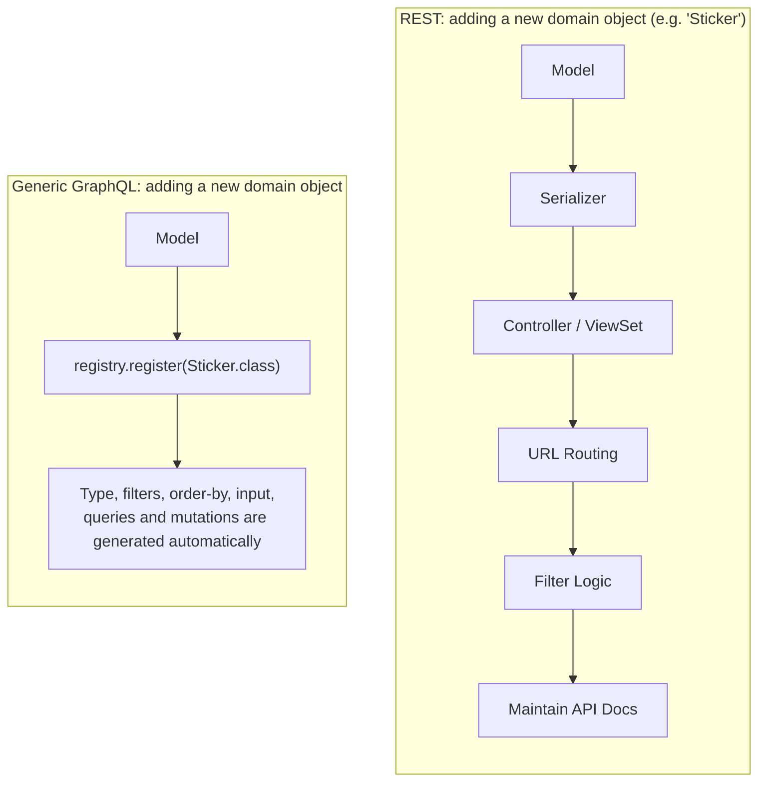
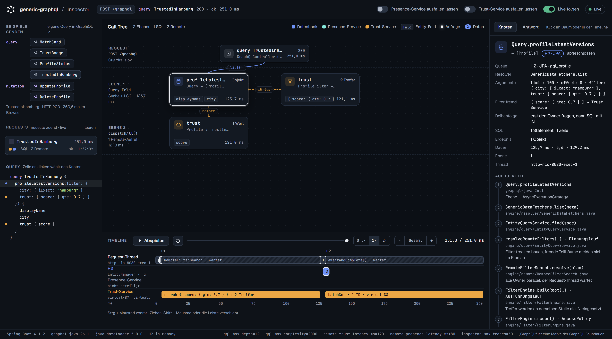
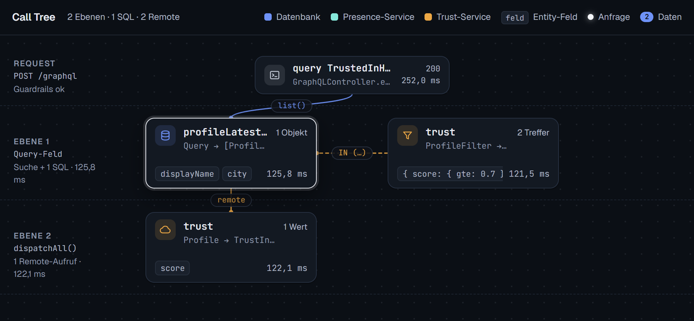
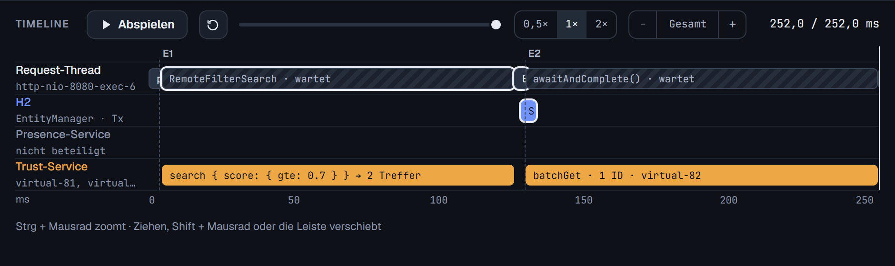
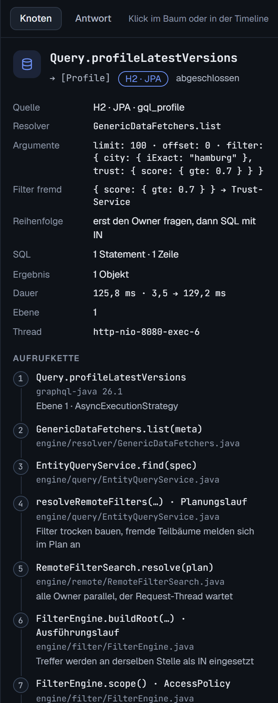

*[Deutsche Version](README.de.md)*

---

# Why a Generic GraphQL Schema? – The View from the Client's Side

*Example domain: a dating app (profiles, matches, interests, chats) – used
to illustrate the principle for a dating-app dev team.*

## Core Idea

> The backend builds a **data structure + a catalog of capabilities**
> exactly once. From then on, the **client** decides which data it
> combines, filters, sorts, and queries historically – without ever
> requiring new backend code to be written.



The backend turns from an "endpoint provider" into a **data source with
capabilities**. The business decision – *which* data, in *which*
combination, for *which* screen/feature – moves to where it actually
originates: the client (app team, web team, data science team, ...).

---

## The Same Use Case: REST vs. Generic GraphQL

 &nbsp;<span style="font-size: 1.8em; font-weight: bold; vertical-align: middle;">vs.</span>&nbsp; 

Use case: "Show me, for a match, the other user's profile, their
interests, and their photos."

### REST (classic) – one call per relationship



Every new relation in the chain means another roundtrip. Each endpoint
also returns its full, fixed response object – including fields the
client doesn't even need for this screen (e.g. internal scoring values in
the match object that only the recommendation algorithm uses).

### Generic GraphQL – one request, client decides depth and fields



```graphql
query {
  matchById(id: "MATCH-8841") {
    matchedAt
    profile {
      displayName
      bio
      interests { name }
      photos { url }
    }
  }
}
```

This single request is enough for the "match card" screen in the app.
For the detail screen, the same client simply requests more fields (e.g.
`lastActiveAt`, `verifiedAt`) – without any backend change. Internally the
backend batches this relation resolution via a dataloader (no N+1
problem) – invisible to the client, which only sees: one request, one
tailored response.

---

## Comparison Table

| Dimension | REST (classic) | Generic GraphQL |
|---|---|---|
| Endpoints | 1 endpoint per resource, often plus special parameters (`?include=`, `?expand=`) | 1 endpoint for all domain objects (profiles, matches, interests, messages, ...) |
| Field selection | Fixed per serializer → over-/under-fetching common (e.g. swipe card also loads the full profile) | Client selects fields per query, exactly as needed per screen |
| Loading relations | Multiple roundtrips or manually maintained `include` logic | Nested to any depth, one request, dataloader-batched |
| Filtering/sorting | Implemented individually per endpoint, usually only basic filters (e.g. `?minAge=`) | Generic for every object: AND/OR/NOT, full-text search (e.g. bio/interests), filtering across relations |
| History / "state before change X" | Usually not available, or a special endpoint per object | Available automatically, e.g. for trust & safety reviews: "what did the profile look like before it was reported?" |
| Writing (create/update/delete) | Own routes/verbs per resource, behavior varies (profile update ≠ match creation ≠ sending a message) | One unified mutation pattern for all objects |
| Type information | Separate OpenAPI/Swagger document, must be kept up to date manually | Introspection – schema is always current, codegen directly possible (e.g. typed Swift/Kotlin/TS clients) |
| New client requirement | Usually a new endpoint/parameter → needs a backend sprint (e.g. "show me shared interests in the match") | Usually already expressible via a different query structure, no deploy needed |
| Effort per new domain object | Model, serializer, controller, routing, filters, docs | Register the model – everything else is generated automatically |



---

## What the Client Concretely Gains

**1. Exactly the data it needs – no more, no less.**
The swipe card only loads `displayName`, `age`, `photos` – not the entire
profile including verification status, reports, or internal matching
scores. The profile detail screen, on the other hand, requests more
fields in the same query.

**2. Arbitrary navigation depth in a single request** (see comparison
above) – the client decides the depth, not the backend. A chat screen
can, for instance, load `conversation → messages →
sender.profile.photo` in one query.

**3. Filter, sort, and full-text search on its own – without consulting
the backend team.**
"Show me matches with the shared interest 'climbing' within a 20 km
radius, sorted by `lastActiveAt`" – a filter combination that nobody
explicitly anticipated when building the Interest or Match object is
still immediately usable.

**4. History for free.**
For trust & safety or support: "What did the profile look like before it
was reported?" or "When was verification revoked?" are ordinary queries,
not a special request to the backend.

**5. Unified, predictable write behavior.**
Whether it's a profile update, a new match, a sent message, or a report –
all follow the same mutation pattern. A client team learns the behavior
once and applies it to every domain object.

**6. Always up-to-date type information.**
Introspection exposes the entire schema to tooling – codegen for
iOS/Android/web clients, autocompletion, type checking – automatically
current, with no maintained API document going stale between app
releases.

**7. New requirements don't stall progress.**
The growth team wants to show "shared interests directly in the match
object" tomorrow? If Interest is already modeled as a relation, that's
just a new query – no sprint needed for a new backend feature.

---

## What the Backend Team Gets Out of It (in short)

- Adding a new domain object = **one registration**, not model +
  serializer + controller + routing + filters + docs
- No growing list of special-case endpoints that each need to be
  maintained individually (no `GET /matches/:id/common-interests` as a
  one-off)
- A fix/feature in the filter engine takes effect immediately for **all**
  domain objects
- A central place for authorization checks instead of scattered checks
  per endpoint (e.g. "edit your own profile" vs. "read-only for others'
  profiles")

---

## Live Dashboard: Watch Every Request Being Resolved

A generic engine resolves a lot behind the scenes: resolvers, dataloader
batches, SQL, calls to other services. The built-in **Inspector** makes
that visible. It records every request to `POST /graphql` – whether it
comes from the page itself, GraphiQL, `curl`, or a test – and shows it
live as a call trace.

```bash
./gradlew bootRun
# Browser: http://localhost:8080/inspector
```



Example: `profileLatestVersions(filter: { city: "hamburg", trust: { score: { gte: 0.7 } } })`
– the `trust` filter lives in another service, so the engine asks that
service first and only then runs the SQL. The page has three areas, shown
in detail below: call tree and timeline in the middle, node details on the
right. On the left you send example queries and pick a recorded request.

### 1. Call Tree – which field is resolved by whom

One node per field with its own resolver, arranged by level. It shows
the resolver, the number of objects, the duration, and what was
triggered: dataloader batches, SQL statements, remote calls. The remote
filter search sits right next to the field it constrains.



### 2. Timeline – what ran in parallel, what waited

Lanes for the request thread, the database, and every remote service.
Waiting time is hatched, errors are red. Here you can see that the
filter search at the Trust service has to finish *before* the SQL runs –
and that the value for the `trust` field is fetched afterwards. Play the
request back at 0.5×/1×/2×, scrub through it, and zoom in.



### 3. Node details – call chain, SQL, result

Click any node to see its facts (source, arguments, order of execution),
the call chain with the location in the code, the batch key, the SQL with
parameters filled in, and the node's slice of the response.



The two switches in the header take the simulated Trust and Presence
services down (`503`). That demonstrates the difference between a failed
remote *field* (only that field becomes `null`, partial result) and a
failed remote *filter* (the whole query fails).

> **Development tool.** The page shows query text, SQL with parameters,
> and full responses – without authentication. Outside local development,
> set `inspector.enabled=false`.

Details, endpoints, and configuration: [docs/INSPECTOR.md](docs/INSPECTOR.md) (German).

---

## Running Against a Real Database (Docker Compose)

By default the app runs on H2 in memory. For a more realistic scenario there
are two Spring profiles, `postgres` and `mysql`. With one of them active,
Spring Boot starts the matching container from [compose.yaml](compose.yaml)
itself and waits until the database is healthy – no manual `docker compose up`
needed (Docker must be running). The container keeps running after the app
ends, which makes restarts fast.

| Profile | Database | Start |
|---|---|---|
| *(none)* | H2 in-memory | `./gradlew bootRun` |
| `postgres` | PostgreSQL 17 (`localhost:5432`) | `./gradlew bootRun --args="--spring.profiles.active=postgres"` |
| `mysql` | MySQL 8.4 (`localhost:3306`) | `./gradlew bootRun --args="--spring.profiles.active=mysql"` |

**VS Code:** `.vscode/launch.json` has a launch configuration per database
("PostgreSQL via Docker", "MySQL via Docker") – pick it in *Run and Debug*
and press start. Each one just sets `SPRING_PROFILES_ACTIVE`.

To manage the containers by hand: `docker compose up -d --wait postgres`
(or `mysql`), `docker compose down` to stop, `docker compose down -v` to also
delete the data.

The schema is created on every start (`ddl-auto=create-drop`) and filled by
the `DataSeeder`, so each run begins with the same demo data. The engine uses
no database-specific SQL; the Inspector shows which database it is talking to.
Credentials and ports are in [compose.yaml](compose.yaml) and
`application-postgres.properties` / `application-mysql.properties`.

The test suite stays on H2: several integration tests pin their own H2 URL to
stay isolated from one another.

---

## Staying Honest: The Price of This Freedom

- **Guardrails instead of control**: The backend gives up control over
  *what* is queried, and must instead centrally enforce *how much*
  (limits, nesting depth, query complexity, rate limiting) – otherwise an
  "overly free" client or a malicious request can build expensive/deep
  queries (relevant for a dating app: e.g. preventing mass scraping of
  other users' profiles).
- **Object-based authorization remains mandatory**: "Only your own
  messages/matches are visible" must be enforced centrally at the data
  layer, not optionally per field.
- **Less use-case documentation**: There is no endpoint that documents a
  concrete use case – the schema describes capabilities, not intentions.
  The client must know on its own which query it needs.
- **The freedom ends at the database boundary**: Filtering, sorting,
  full-text search and history are built from SQL. Data that lives in
  another microservice (e.g. the trust level in a trust service) can still
  be selected. Filtering only works if the service that owns the data
  answers that question itself – it keeps data ownership. How that looks
  and where its limits are is described in
  [docs/GQL2-MICROSERVICES.md](docs/GQL2-MICROSERVICES.md) (German).

These points are solvable (query complexity limits, object-based access
checks per resolver, persisted queries/allowlisting for public clients) –
but they must be considered from the start, not bolted on afterward.

---

## Takeaway

**The backend provides the map, the client chooses the route.**
Build the data structure + capabilities once – after that, every client
team (app, web, support tooling, data) decides what it needs, when, and
in which combination.
