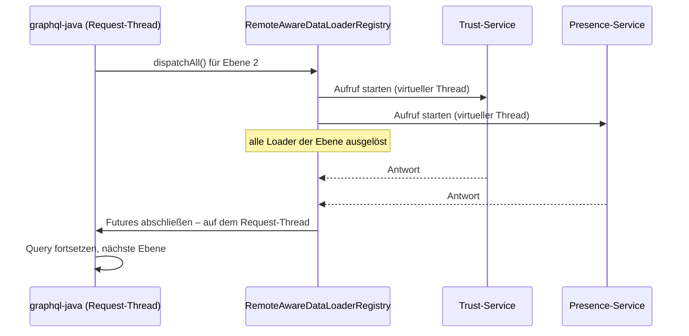
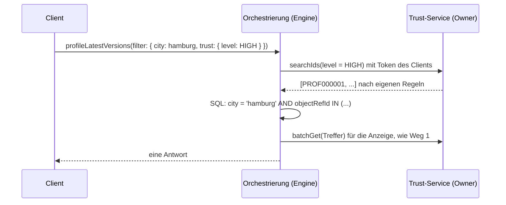

# Szenario: Generisches GraphQL als Orchestrierungsschicht über Microservices

Bisher liegt im Beispiel alles in einer Datenbank. In einer echten Landschaft ist
diese Anwendung oft nur die **Orchestrierungssicht**: Ein Teil dessen, was das
Schema anbietet, gehört anderen Services mit eigener Datenbank.

Im Beispiel gehört die Vertrauensbewertung eines Profils dem **Trust-Service**:
Vertrauensstufe, offene Meldungen, letzte Prüfung. Das Profil selbst liegt weiter
hier. Die Frage ist, was von den Fähigkeiten der generischen Engine dann noch trägt.

Weiterführend: [Beispielimplementierung](GQL2-JAVA-IMPLEMENTIERUNG.md) ·
[Architekturskizze](GQL2-JAVA.md) · [Client-Sicht](../README.de.md)

Leitplanke für dieses Kapitel ist die **Datenhoheit**: Der Service, dem die Daten
gehören, ist dafür verantwortlich, was davon ausgespielt wird – an wen, in welchem
Stand und auf welche Fragen hin. Die Orchestrierung darf diese Verantwortung nicht
übernehmen, auch nicht stillschweigend über eine Kopie.

## Kurzantwort

**Teilweise.** Felder aus einem fremden Service lassen sich abfragen, verschachtelt
und gebündelt ([Weg 1](#weg-1-remote-felder-lauffähig-im-beispiel)). Filter lassen
sich an den Owner delegieren, mit Einschränkungen
([Weg 2](#weg-2-filter-an-den-owner-delegieren-konzept)). Sortierung, Volltextsuche
und Stichtag über Servicegrenzen hinweg gibt es nur, soweit der Owner sie selbst
anbietet.

| Fähigkeit | Daten in der eigenen DB | Weg 1: Remote-Feld | Weg 2: Filter-Delegation |
|---|---|---|---|
| Abfragen, beliebig verschachtelt | ✅ | ✅ ein Aufruf pro Ebene | ✅ wie Weg 1 |
| Filter (UND mit lokalen Filtern) | ✅ | ❌ nicht im Filter-Typ | ✅ Owner liefert passende IDs |
| `NOT` / `OR` über beide Quellen | ✅ | ❌ | ⚠️ `NOT` ja, `OR` aufwändig |
| `order` mit `limit`/`offset` | ✅ | ❌ nicht im OrderBy-Typ | ⚠️ nur bei begrenzten Treffermengen |
| `WILDCARDFILTER` | ✅ | ❌ wird übergangen | ⚠️ nur, wenn der Owner Textsuche anbietet |
| Stichtag `date` | ✅ | ❌ nur, wenn der Owner Stände kennt | ❌ dito |
| Löschschutz, `*Relations` | ✅ | ❌ | ❌ |
| Wer entscheidet, was sichtbar und filterbar ist | Orchestrierung | Owner | Owner |
| Aktualität | sofort | sofort | sofort |
| Bei Ausfall des Owners | – | Teilergebnis | Query schlägt fehl |

## Das Dilemma: Datenhoheit, freie Abfragen, keine Kopien

Drei Dinge lassen sich nicht gleichzeitig haben:

1. **Datenhoheit beim Owner** – er entscheidet, was ausgespielt wird.
2. **Beliebig über Domänen hinweg filtern, sortieren und blättern**, in einem Request.
3. **Keine Datenkopien** außerhalb des Owners.

| Man wählt … | … und bekommt |
|---|---|
| 2 + 3 | eine gemeinsame Datenbank – der Stand des Beispiels vor diesem Kapitel |
| 1 + 2 | Kopien beim Konsumenten (siehe [Randnotiz](#randnotiz-kopie-über-events-nur-mit-vertrag-des-owners)) |
| 1 + 3 | eingeschränkte Abfragen über Servicegrenzen – **Weg 1 und Weg 2** |

Wenn Datenhoheit ein festes Prinzip ist, bleibt die letzte Zeile. Die Frage ist dann
nicht, *ob* man Fähigkeiten aufgibt, sondern *welche* – und wie viele man über den
Owner zurückholen kann, ohne seine Hoheit zu verletzen.

Ein Punkt wird dabei leicht übersehen: **Filtern ist auch Lesen.** Mit
`filter: { openReports: { gt: 0 } }` erfährt ein Client, wer gemeldet wurde, auch
wenn er `openReports` nie angezeigt bekommt. Ob über ein Feld gefiltert werden darf,
muss deshalb der Owner entscheiden – nicht die Orchestrierung.

## Warum die Grenze genau dort verläuft

Die Engine übersetzt eine Query in **ein** SQL-Statement. Filter über Relationen
werden zu korrelierten `EXISTS`-Subqueries, `order` zu Joins, der Stichtag zu einer
`NOT EXISTS`-Bedingung (siehe [GQL2-JAVA-IMPLEMENTIERUNG.md](GQL2-JAVA-IMPLEMENTIERUNG.md)).
Daten in einer fremden Datenbank kommen in diesem Statement nicht vor.

Das ist keine Lücke dieser Implementierung, sondern liegt in der Sache. Wer
`limit: 20` nach einem fremden Feld sortiert haben will, muss entweder alle
Kandidaten laden und im Speicher sortieren oder die Daten dort haben, wo
sortiert wird.

---

## Weg 1: Remote-Felder (lauffähig im Beispiel)

Ein Remote-Feld hängt einen Wert aus einem fremden Service an einen lokalen Typ.
Die Engine lädt ihn per DataLoader nach: ein Aufruf pro Query-Ebene für alle
Schlüssel dieser Ebene.

### Konfiguration

`config/RegistryConfig.java`:

```java
registry.register(eventSourced(Profile.class, "profile")
        .remoteField(RemoteField.of("trust", TrustInfo.class)
                .source("Trust-Service")
                .keyAttribute("objectRefId")
                .timeout(Duration.ofSeconds(2))
                .loader((profileIds, context) -> trustService.batchGet(profileIds))
                .build())
        .remoteField(RemoteField.of("presence", PresenceInfo.class)
                .source("Presence-Service")
                .keyAttribute("objectRefId")
                .timeout(Duration.ofMillis(500))
                .loader((profileIds, context) -> presenceService.batchGet(profileIds))
                .build())
        .build());
```

`TrustInfo` ist ein Record, also das, was über die Leitung kommt. Der
`TrustServiceClient` ist ein Interface. Im Beispiel steckt dahinter der
`SimulatedTrustService` mit eigener „Datenbank“ (einer Map), künstlicher Latenz
(`remote.trust.latency-ms`) und Aufrufprotokoll. In einer echten Landschaft wäre
das ein HTTP-Client für `POST /trust/profiles:batchGet`.

Der **Presence-Service** (online, schreibt gerade, Gerät) ist nach demselben Muster
gebaut. Es gibt ihn vor allem, um zu zeigen, dass
[mehrere Services auf einer Ebene parallel](#mehrere-services-auf-einer-ebene-parallel)
gefragt werden.

| Baustein | Datei |
|---|---|
| Registrierung | `engine/remote/RemoteField.java` |
| Remote-Loader: Aufruf starten | `engine/remote/RemoteFieldLoaders.java` |
| Offene Aufrufe, gemeinsames Warten, Timeout, Fehler | `engine/remote/RemoteCalls.java` |
| Warten nach jeder Ebene | `engine/remote/RemoteAwareDataLoaderRegistry.java` |
| Objekttyp aus dem Record | `GqlTypeFactory.buildRemoteType` |
| Resolver | `GenericDataFetchers.remote` |
| Simulierte Services | `remote/SimulatedRemoteService.java`, `remote/trust/…`, `remote/presence/…` |

### Was im Schema entsteht

```graphql
type Profile {
  # ... alle lokalen Felder wie bisher
  "Aus Trust-Service nachgeladen (ein Aufruf pro Ebene). Nicht filterbar, nicht sortierbar, nicht im WILDCARDFILTER."
  trust: TrustInfo
  "Aus Presence-Service nachgeladen (ein Aufruf pro Ebene). Nicht filterbar, nicht sortierbar, nicht im WILDCARDFILTER."
  presence: PresenceInfo
}

"Gehoert Trust-Service - wird nicht aus der eigenen Datenbank gelesen."
type TrustInfo {
  level: TrustLevel
  score: BigDecimal
  openReports: Int
  lastReviewedOn: Date
  note: String
}
```

`PresenceInfo` (`status`, `typing`, `device`) entsteht genauso. `ProfileFilter` und
`ProfileOrderBy` bekommen **weder** `trust` **noch** `presence`. Die Grenze ist
im Schema sichtbar und damit auch in GraphiQL und im Codegen der Clients.

### Ein Request, zwei Datenquellen

```graphql
query TrustBadge {
  matchLatestVersions(order: { matchedAt: DESC }) {
    objectRefId
    profileA { displayName trust { level } }
    profileB { displayName trust { level openReports } }
  }
}
```

Im Log steht genau ein Aufruf:

```
Trust-Service: 1 Aufruf fuer 3 Profile [PROF000005, PROF000001, PROF000003]
```

(Die Reihenfolge der IDs ist nicht festgelegt – der DataLoader übergibt eine Menge.)

Mara ist in beiden Matches `profileA`, der DataLoader fragt sie trotzdem nur einmal
an. Profile aus der eigenen DB und Vertrauensstufen aus dem Trust-Service kommen in
einer Antwort zurück. Für den Client ist nicht erkennbar, woher welches Feld stammt.

### Mehrere Services auf einer Ebene: parallel

```graphql
query ProfileStatus {
  profileLatestVersions(order: { displayName: ASC }) {
    displayName
    trust    { level }
    presence { status typing }
  }
}
```

`trust` und `presence` liegen auf derselben Ebene und hängen nicht voneinander ab.
Beide Aufrufe sind **gleichzeitig** unterwegs, die Ebene dauert so lange wie der
langsamere Service – nicht so lange wie beide zusammen:

Gemessen mit `./gradlew bootRun` (simulierte Latenz Trust 120 ms, Presence 80 ms;
Median aus fünf Läufen, Profile-Liste ohne Remote-Felder ≈ 10 ms):

| Query auf `profileLatestVersions` | Antwortzeit |
|---|---|
| nur `trust` | ≈ 132 ms |
| nur `presence` | ≈ 92 ms |
| `trust` und `presence` – parallel (jetzt) | ≈ 132 ms |
| `trust` und `presence` – nacheinander (erste Version, rechnerisch) | ≈ 210 ms |

Im Log starten beide Aufrufe in derselben Millisekunde, auf zwei verschiedenen
virtuellen Threads:

```
12:38:56.772 [virtual-97] Trust-Service: 1 Aufruf fuer 3 Profile [...]
12:38:56.772 [virtual-98] Presence-Service: 1 Aufruf fuer 3 Profile [...]
```

Bei drei, vier Services auf einer Ebene wächst der Unterschied entsprechend: Die
Wartezeit einer Ebene ist das **Maximum** der Latenzen, nicht die Summe.

So funktioniert es:



1. Ein Remote-Loader **startet** seinen Aufruf nur und gibt ein offenes Future
   zurück (`RemoteFieldLoaders`).
2. Der gestartete Aufruf wird pro Request vermerkt (`RemoteCalls`).
3. graphql-java löst die Loader einer Ebene über `dispatchAll()` aus. Die eigene
   `RemoteAwareDataLoaderRegistry` ruft erst `super.dispatchAll()` auf – jetzt sind
   alle Aufrufe der Ebene unterwegs – und wartet dann gemeinsam auf sie.
4. Erst wenn alle Antworten (oder Timeouts) da sind, werden die Futures
   abgeschlossen, und zwar **auf dem Request-Thread**. Die Query läuft dort weiter,
   wo Transaktion und EntityManager der lokalen DataLoader liegen.

**Was sich nicht parallelisieren lässt:** Remote-Felder auf **verschiedenen** Ebenen.
`profile { photos { moderation { … } } }` kann einen Moderations-Service erst fragen,
wenn die Fotos geladen sind – die IDs entstehen erst aus diesem Ergebnis. Das liegt
an den Daten, nicht an der Implementierung. Bei einem komplexen Datenmodell bestimmt
deshalb die **Zahl der Ebenen mit Remote-Feldern** die Latenz, nicht die Zahl der
Remote-Felder.

### Filtern geht nicht – und das Schema sagt es

```graphql
query TrustFilter {
  profileLatestVersions(filter: { trust: { level: { exact: HIGH } } }) {
    displayName
  }
}
```

Die Query wird schon bei der Validierung abgelehnt, bevor irgendein Service
gefragt wird:

```
Validierungsfehler (WrongType@[profileLatestVersions]) : Argument 'filter' mit Wert '...'
enthält ein Feld nicht in 'ProfileFilter': 'trust'
```

(graphql-java lokalisiert Validierungsfehler nach der Locale der JVM – auf einem
englischen System lautet die Meldung entsprechend „contains a field not in …“.)

### Die Volltextsuche übergeht das Remote-Feld

```graphql
query TrustWildcard {
  profileLatestVersions(filter: { WILDCARDFILTER: { iContains: "ausweis" } }) {
    displayName
    trust { note }
  }
}
```

Liefert `[]`, obwohl Maras Prüfnotiz „Ausweis geprueft, …“ lautet. Der
Wildcard-Filter durchsucht die selektierten Felder, aber nur, soweit sie in SQL
stehen. Das Versprechen „was du abfragst, wird durchsucht“ gilt für Remote-Felder
also nicht. Die Feldbeschreibung im Schema weist darauf hin, eine Fehlermeldung
gibt es nicht.

### Stichtag: lokale und fremde Daten laufen auseinander

```graphql
query TrustHistory {
  earlier: profileById(objectRefId: "PROF000001", date: "2025-12-01") { city verifiedAt trust { level note } }
  today:   profileById(objectRefId: "PROF000001")                     { city verifiedAt trust { level note } }
}
```

`earlier` zeigt Hamburg und `verifiedAt: null`, das ist der lokale Stand vom
Dezember. Zugleich zeigt es `trust.level: HIGH` und „Ausweis geprueft“, also den
**heutigen** Stand des Trust-Service. Der Service kennt keine Historie.

Die Engine reicht den Stichtag über `RemoteCallContext.date()` an den Loader weiter.
Was der fremde Service damit macht, liegt nicht in ihrer Hand. Für Trust-&-Safety-
Reviews („wie sah das Profil vor der Meldung aus?“) ist genau dieser Fall heikel.
Lösen kann ihn nur der Owner selbst, indem er Stände zu einem Stichtag anbietet.
Das ist eine Anforderung an seine API, keine an die Orchestrierung.

### Ausfall: Teilergebnis statt Totalausfall

```graphql
query ProfileCard {
  profileById(objectRefId: "PROF000001") {
    displayName
    city
    photos { url }
    trust { level openReports }
  }
}
```

Ist der Trust-Service nicht erreichbar oder antwortet er nicht innerhalb des
Timeouts, bleibt der Rest der Antwort erhalten:

```json
{ "errors": [ { "message": "Exception while fetching data (/profileById/trust) : Trust-Service nicht erreichbar: 503 Service Unavailable",
                "path": ["profileById", "trust"] } ],
  "data": { "profileById": { "displayName": "Mara", "city": "Leipzig",
                             "photos": [ { "url": "https://cdn.example.test/mara-1.jpg" }, { "url": "https://cdn.example.test/mara-2.jpg" } ],
                             "trust": null } } }
```

Das ist ein echter Vorteil von GraphQL gegenüber einem REST-Aggregat, das bei einem
fehlenden Teil oft komplett mit 502 antwortet. Der Client muss aber damit rechnen,
dass `trust` `null` sein kann, obwohl das Profil existiert.

Ausfälle sind dabei **pro Service** getrennt: Ist nur der Trust-Service weg, liefert
`ProfileStatus` weiterhin `presence` für alle Profile, nur `trust` ist `null`.

### Designentscheidungen

- **Remote-Aufrufe einer Ebene laufen parallel, abgeschlossen wird auf dem
  Request-Thread.** Siehe [oben](#mehrere-services-auf-einer-ebene-parallel) und
  [Entscheidung E2](#e2-remote-aufrufe-parallel-mit-gemeinsamem-warten-pro-ebene).
- **Der Timeout zählt ab dem Start des Aufrufs**, nicht ab dem Beginn des Wartens.
  Fällt ein Service aus, kostet das höchstens seinen eigenen Timeout – parallel zu
  den anderen, nicht zusätzlich.
- **Sicherheitsnetz gegen hängende Requests.** Jedes Future hat zusätzlich ein
  `orTimeout` (Timeout + 1 s). Das greift nur, wenn das gemeinsame Warten nie
  aufgerufen wird – etwa wenn jemand in graphql-java das DataLoader-Chaining
  aktiviert, das `dispatchAll()` umgeht. Dann gibt es einen Fehler im Feld statt eines
  Requests, der nie endet.
- **Die DB-Transaktion bleibt während des Aufrufs offen.** Der Controller ist
  `@Transactional`, also hält jeder Remote-Aufruf eine DB-Verbindung fest. Für ein
  Beispiel ist das in Ordnung. In Produktion würde man die Request-Transaktion
  durch kurze `readOnly`-Transaktionen pro Loader ersetzen.
- **`AccessPolicy` reicht nicht über die Grenze.** Sie erzeugt ein SQL-Predicate.
  Der fremde Service muss selbst prüfen. Den Kontext dafür (z. B. das Token des
  Aufrufers) bekommt der Loader über `RemoteCallContext.graphQLContext()`.
- **Guardrails zählen ein Remote-Feld wie jedes andere.** Ein Remote-Aufruf ist
  aber teurer als ein Join. Eine Gewichtung in `Guardrails.maxComplexity` wäre der
  nächste Schritt.

---

## Weg 2: Filter an den Owner delegieren (Konzept)

Ein Filter auf ein fremdes Feld wird nicht in SQL übersetzt, sondern als **Frage an
den Owner** gestellt: „Welche Profile erfüllen `level = HIGH`?“ Der Owner wertet
sie mit seinen eigenen Regeln und Berechtigungen aus und liefert IDs zurück. Die
Engine macht daraus `objectRefId IN (…)` und rechnet den Rest wie gewohnt in SQL,
einschließlich `limit`/`offset`.



### Warum das die Datenhoheit wahrt

- **Der Owner entscheidet, welche Felder filterbar sind.** Nur die erscheinen im
  Filter-Typ. `openReports` kann anzeigbar sein und trotzdem nicht filterbar.
- **Der Owner wendet seine Berechtigungen auf die Suche an**, nicht erst auf die
  Anzeige. Ein Client ohne Trust-&-Safety-Rolle bekommt auf `level = LOW` eine
  leere Menge oder einen Fehler – je nachdem, was der Owner festlegt.
- **Die Daten liegen nirgends sonst.** Es gibt keine Kopie, die veraltet, die
  gelöscht werden muss oder die jemand „korrigiert“.
- **Der Stand ist immer der aktuelle** – es gibt keinen Rückstand wie bei Events.

### Wie es in die Engine passen würde

Das Remote-Feld aus Weg 1 bekommt optional eine Suchfunktion und eine Liste
filterbarer Felder:

```java
registry.register(eventSourced(Profile.class, "profile")
        .remoteField(RemoteField.of("trust", TrustInfo.class)
                .source("Trust-Service")
                .loader((profileIds, context) -> trustService.batchGet(profileIds))
                // neu: vom Owner freigegebene Filterfelder und seine Such-API
                .filterInclude("level", "score")
                .search((filter, context) -> trustService.searchIds(filter, context))
                .maxIds(5_000)
                .build())
        .build());
```

- `GqlTypeFactory` erzeugt daraus `TrustInfoFilter` mit genau `level` und `score`
  und hängt ihn als `trust` an `ProfileFilter`.
- `FilterEngine.buildField` erkennt das Remote-Feld, ruft **vor** dem Absetzen des
  SQL die Suche auf und gibt `root.get("objectRefId").in(ids)` als Predicate zurück.
  Der Rest der Filter-Engine – `AND`, Relationen, Scope – bleibt unverändert.
- Betreibt der Owner selbst diese generische Engine, ist seine Filtersprache
  **dieselbe**. Der Teilfilter wird dann einfach als `profileTrustLatestVersions(filter: …)`
  weitergereicht, und `TrustInfoFilter` kann aus der Introspection seines Schemas
  übernommen werden statt aus einer Liste.

Damit würde dann zum Beispiel das gehen:

```graphql
# Konzept – im Beispiel nicht lauffähig
{
  profileLatestVersions(
    filter: { city: { iExact: "hamburg" }, trust: { level: { exact: HIGH } } }
    order: { lastActiveAt: DESC }
    limit: 20
  ) { displayName lastActiveAt trust { level } }
}
```

Sortiert wird hier nach einem **lokalen** Feld – das geht ohne Einschränkung, weil
die Trefferliste nach dem `IN` vollständig in SQL liegt.

### Die eigentliche Schwierigkeit: die Größe der ID-Mengen

„Alle Profile mit `level = LOW`“ können Millionen sein. Eine `IN`-Liste dieser Größe
überträgt niemand. Zwei Richtungen sind möglich:

| Richtung | Wann | Ablauf |
|---|---|---|
| **Owner zuerst** | fremder Filter ist selektiv (`level = HIGH`, wenige Treffer) | Owner liefert IDs → lokales SQL mit `IN` |
| **Lokal zuerst** | lokaler Filter ist selektiv (`city = hamburg`) | lokale Kandidaten-IDs → Owner: „welche davon erfüllen `level = HIGH`?“ |

Welche Richtung passt, weiß die Engine nicht von selbst. Für den Anfang reicht eine
feste Richtung pro Feld und eine **harte Obergrenze** (`maxIds`). Wird sie
überschritten, bricht die Query mit einer klaren Meldung ab
(„Filter auf trust trifft mehr als 5000 Profile – bitte weiter einschränken“),
statt still ein falsches oder abgeschnittenes Ergebnis zu liefern.

Bei „lokal zuerst“ gilt zusätzlich: `limit`/`offset` darf erst **nach** der Antwort
des Owners angewendet werden. Sonst fehlen Treffer, die außerhalb der ersten
Seite lagen.

### Verknüpfungen und ihre Grenzen

- **`AND`** mit lokalen Filtern: ✅ direkt, siehe oben.
- **`NOT`**: ✅ als `NOT IN` – aber nur, wenn der Owner seine Treffermenge
  vollständig liefert und nicht wegen Berechtigungen kürzt. Sonst wird aus „nicht
  HIGH“ unbemerkt „nicht HIGH oder nicht sichtbar“.
- **`OR`** zwischen lokalem und fremdem Feld: ⚠️ machbar als `local OR objectRefId IN (…)`,
  braucht aber immer die Richtung „Owner zuerst“ und damit die volle fremde
  Treffermenge.
- **`WILDCARDFILTER`**: ⚠️ nur, wenn der Owner eine Textsuche anbietet. Dann wird die
  ID-Menge des Owners mit den lokalen Wildcard-Treffern vereinigt.
- **Sortieren nach einem fremden Feld**: ⚠️ nur bei begrenzten Treffermengen, wenn
  der Owner die IDs geordnet liefert. Die Engine sortiert dann über die Position in
  der Liste (`CASE WHEN … THEN 1 …`). Für große Mengen gibt es keine saubere Lösung.
- **Stichtag**: ❌ nur, wenn der Owner `searchIds` mit Stichtag anbietet.
- **Konsistenz**: ❌ Lokale DB und Owner werden zu zwei leicht verschiedenen
  Zeitpunkten gelesen. Es gibt keinen gemeinsamen Snapshot.

### Was der Owner dafür anbieten muss

Die Delegation verschiebt Arbeit zum Owner. Das ist gewollt, denn er hat die Hoheit,
aber es ist ein Vertrag, den sein Team bauen und betreiben muss:

1. **Eine Such-API**, die Filter entgegennimmt und IDs liefert – im besten Fall die
   generische Engine selbst.
2. **Die Liste filterbarer Felder** als Teil des Vertrags, versioniert.
3. **Berechtigungsprüfung auf der Suche**, mit dem weitergereichten Token des
   Clients (`RemoteCallContext.graphQLContext()`).
4. **Optional:** Stichtag, Textsuche, geordnete Treffer. Jede dieser Fähigkeiten
   schaltet in der Orchestrierung genau eine Zeile der Tabelle oben frei.

### Der Preis

- **Ein Ausfall des Owners lässt die ganze Query scheitern.** Bei Weg 1 fehlt nur
  ein Feld. Ein Filter ohne Antwort des Owners würde dagegen ein falsches Ergebnis
  liefern – deshalb muss die Engine hier abbrechen statt ein Teilergebnis zu geben.
- **Zwei Aufrufe pro Query** mit fremdem Filter: einer für die Suche, einer für die
  Anzeige. Bei „lokal zuerst“ hängt die Latenz zusätzlich an der lokalen Abfrage.
- **Last beim Owner.** Jeder Client-Filter wird zu einer Suche in seinem Service.
  Die Guardrails der Orchestrierung müssen das mitzählen.

### Was der Engine dafür noch fehlt

1. `filterInclude`, `search` und `maxIds` an `RemoteField`, und ein
   `buildRemoteFilterType` in `GqlTypeFactory`.
2. Der Remote-Zweig in `FilterEngine.buildField` – einschließlich der Regel, dass
   ein Fehler des Owners die Query abbricht.
3. Eine Entscheidung für `OR` und `NOT`: unterstützen oder mit klarer Meldung
   ablehnen. Für einen ersten Schritt ist Ablehnen ehrlicher.
4. Remote-Filter in Relations-Subqueries (`matchLatestVersions(filter: { profileB: { trust: … } })`).
   Das `IN` funktioniert dort genauso, aber die Suche muss vor dem Zusammenbau
   der gesamten Criteria-Query laufen.

---

## Randnotiz: Kopie über Events (nur mit Vertrag des Owners)

Technisch naheliegend wäre es, die Daten des Trust-Service per Events in eine lokale,
event-gesourcte Entity zu replizieren. Dann wäre `trust` eine normale Relation, und
alle Fähigkeiten aus der Tabelle oben – Filter, Sortierung, Wildcard, Stichtag –
funktionierten ohne Einschränkung. Die Engine passt dazu sogar gut: Eingehende
Events wären `update`-Events mit `validFrom`, und weil Snapshots aus allen Events
neu aufgebaut werden, landen auch verspätete Events an der richtigen Stelle.

**Mit dem Leitprinzip dieses Kapitels ist das nicht vereinbar.** Mit der Kopie
entscheidet die Orchestrierung, wer was sieht, wonach gefiltert werden darf und wie
aktuell der Stand ist. Die Verantwortung für das, was ausgespielt wird, wandert vom
Owner weg.

Zulässig wäre es nur, wenn der **Owner selbst** einen Lesestand als Vertrag
veröffentlicht und verantwortet – mit festgelegten Feldern, Aktualitätszusage
(SLA), Löschweitergabe (DSGVO) und Regeln, wer filtern darf. Ob eine Organisation
das erlaubt, ist eine Governance-Frage, keine technische. Für das Dating-Beispiel
mit sensiblen Trust-&-Safety-Daten ist es **nicht** die Empfehlung.

---

## Weg 3: Federation (Ausblick)

Jeder Service betreibt sein eigenes GraphQL-Schema, gern auch mit dieser Engine,
und ein Gateway setzt die Schemas zu einem zusammen. Das passt zur Datenhoheit:
Jeder Teil des Schemas wird von seinem Owner ausgeliefert.

Die Frage nach servicesübergreifenden Filtern löst es aber nicht von selbst. Ein
Gateway, das `trust: { level: HIGH }` an den Trust-Service weiterreicht und das
Ergebnis mit lokalen Filtern verschneidet, macht genau das, was Weg 2 beschreibt –
nur an anderer Stelle. Federation ist damit eine Entscheidung darüber, **wo** die
Delegation stattfindet, nicht ein Ersatz dafür. Die Engine bräuchte dafür außerdem
einen `_entities`-Resolver; der ließe sich auf den vorhandenen `byId`-DataLoader
abbilden.

---

## Entscheidungshilfe

Für jedes Feld, das einem anderen Service gehört:

| Frage | Ja → | Nein → |
|---|---|---|
| Wird es nur angezeigt? | Weg 1 | weiter |
| Muss danach gefiltert werden, und gibt der Owner das Feld zum Filtern frei? | Weg 2 | weiter |
| Muss in großen Mengen danach sortiert oder blätternd gesucht werden? | Anforderung an den Owner: eigene Such-Query, die der Client direkt nutzt | weiter |
| Wird ein Stand zu einem Stichtag gebraucht? | Anforderung an den Owner: Historie in seiner API | – |
| Gehört eine ganze Domäne einem anderen Team, mit eigenen Clients? | zusätzlich Weg 3 | – |

Für das Dating-Beispiel heißt das:

- **Vertrauensstufe auf der Profilkarte** – Weg 1.
- **„Zeig nur verifizierte Profile“** – Weg 2, sofern der Trust-Service `level` zum
  Filtern freigibt. Die Treffermenge (`HIGH`) ist klein genug für „Owner zuerst“.
- **„Alle gemeldeten Profile, sortiert nach Anzahl der Meldungen“** – gehört gar
  nicht in die Orchestrierung. Das ist ein Trust-&-Safety-Werkzeug, und der
  Trust-Service bietet es selbst an.
- **„Schreibt gerade“ im Chat** – Weg 1 über den Presence-Service. Live-Daten, die nie
  gefiltert werden.

---

## Entscheidungen

Getroffene Entscheidungen zu diesem Szenario, mit Begründung – damit später
nachvollziehbar ist, warum es so gebaut ist und was dafür aufgegeben wurde.

### E1: Datenhoheit bleibt beim Owner – keine Kopien fremder Daten

*Stand: 2026-10-25*

- **Kontext:** Für Filter, Sortierung und Historie über fremde Felder läge eine
  lokale Kopie per Events nahe; die Engine passt technisch gut dazu.
- **Entscheidung:** Fremde Daten werden nicht in die Orchestrierung repliziert. Der
  Service, dem die Daten gehören, ist dafür verantwortlich, was davon ausgespielt
  wird – einschließlich der Frage, wonach gefiltert werden darf (Filtern ist auch
  Lesen). Fremde Felder werden angezeigt (Weg 1); Filter werden, wo nötig, an den
  Owner delegiert (Weg 2).
- **Konsequenzen:** Sortierung, Volltextsuche und Stichtag über Servicegrenzen gibt es
  nur, soweit der Owner sie anbietet. Ein Ausfall des Owners lässt delegierte Filter
  scheitern. Die Kopie über Events bleibt eine [Randnotiz](#randnotiz-kopie-über-events-nur-mit-vertrag-des-owners)
  für den Fall, dass ein Owner selbst einen Lesestand als Vertrag verantwortet.

### E2: Remote-Aufrufe parallel, mit gemeinsamem Warten pro Ebene

*Stand: 2026-10-25*

- **Kontext:** In der ersten Version wartete jeder Remote-Loader blockierend auf seine
  Antwort. Weil graphql-java die Loader einer Ebene nacheinander auslöst, addierten
  sich die Latenzen aller Remote-Felder einer Ebene. Bei einem Datenmodell mit
  mehreren fremden Services ist das nicht tragbar.
- **Betrachtete Optionen:**
  1. *Nacheinander, blockierend* (erste Version): einfach, aber Summe der Latenzen.
  2. *Starten, dann gemeinsam warten:* Remote-Loader starten nur; eine eigene
     `DataLoaderRegistry` wartet nach `dispatchAll()` auf alle Aufrufe der Ebene und
     schließt die Futures auf dem Request-Thread ab.
  3. *Vollständig asynchron:* `executeAsync`, keine Transaktion über den ganzen
     Request, kurze `readOnly`-Transaktionen pro Loader. Kein Thread wartet, auch
     über Ebenen hinweg nicht.
- **Entscheidung:** Option 2. Sie bringt den Großteil des Gewinns – die Wartezeit
  einer Ebene ist das Maximum statt der Summe – und lässt alles andere unverändert:
  Transaktion, EntityManager, Timeout pro Feld, Teilergebnis bei Ausfall. Die
  Änderung bleibt in `engine/remote`, dazu eine Zeile in `RelationDataLoaders`.
- **Konsequenzen:**
  - Ebenen bleiben nacheinander. Das liegt an den Daten und ändert auch Option 3 nicht.
  - Der Request-Thread wartet pro Ebene einmal. Für hohe Last bleibt Option 3 der
    nächste Schritt – dann aber als Umbau der ganzen Engine, nicht nur der
    Remote-Felder.
  - Die Lösung hängt an der Standard-Dispatch-Strategie von graphql-java
    (`dispatchAll()` pro Ebene, geprüft in graphql-java 26.1). Wer DataLoader-Chaining
    aktiviert, muss das gemeinsame Warten anders auslösen; bis dahin verhindert das
    Sicherheitsnetz (`orTimeout`) hängende Requests.

---

## Grenzen der Beispielimplementierung (Weg 1)

- Ein Remote-Feld liefert genau ein Objekt pro Schlüssel, keine Liste. Der Werttyp
  ist ein flacher Record aus Skalaren und Enums.
- Kein Rückweg: Ein Remote-Typ kann nicht auf lokale Entities verweisen (z. B.
  `TrustInfo.reviewedBy → Profile`).
- Pro Feld gibt es einen Timeout, aber kein Retry und keinen Circuit-Breaker. Ein
  Ausfall kostet bei jedem Request die Wartezeit bis zum Timeout – parallel zu den
  anderen Services, aber eben jedes Mal.
- Remote-Felder auf verschiedenen Ebenen laufen nacheinander (siehe E2).
- Der DataLoader-Cache gilt pro Request. Er ist unabhängig vom Stichtag, wie bei
  den lokalen Relationen auch.

## Tests

`src/test/java/.../RemoteFieldIntegrationTest.java` liest die Queries dieses
Dokuments wörtlich und prüft sie über HTTP: Schema-Grenze, ein Aufruf pro Ebene,
abgelehnter Filter, übergangener Wildcard, Stichtags-Drift, Teilergebnis bei
einem Ausfall – und dass Trust- und Presence-Aufruf sich zeitlich **überlappen**,
also wirklich parallel laufen. Nacheinander ausgeführt wäre der eine beendet, bevor
der andere beginnt; der Test hängt damit nicht an der Geschwindigkeit der Maschine.
